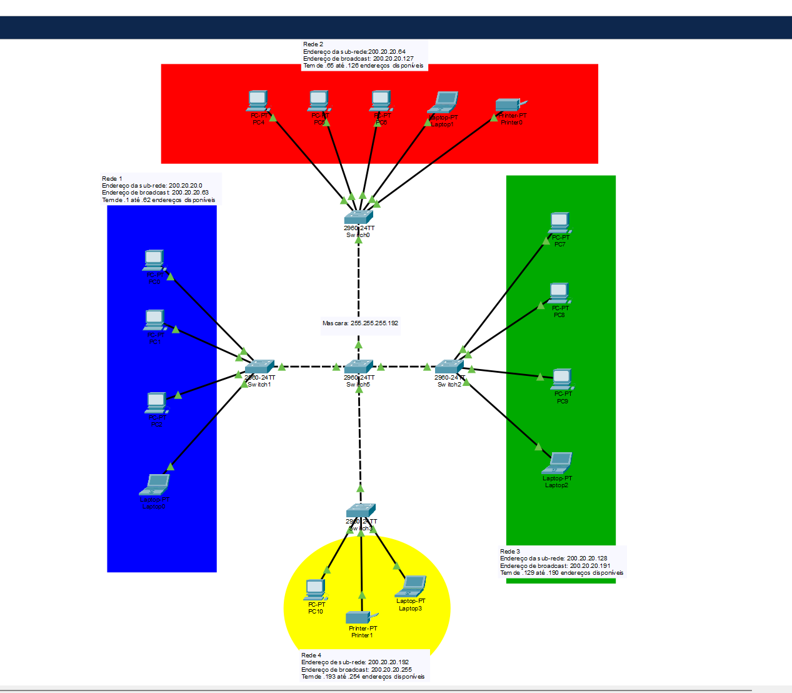
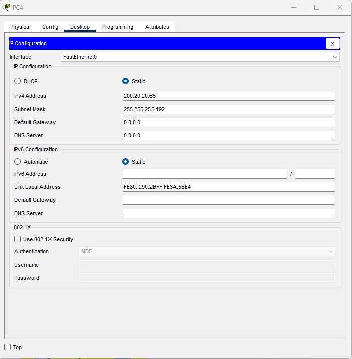
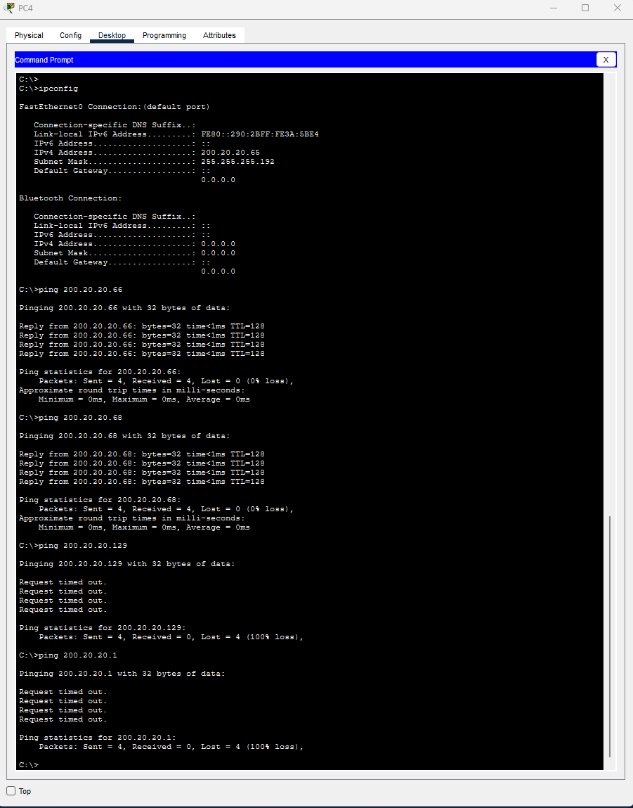

# Network Labs

Exercícios de redes feitos no Cisco Packet Tracer, durante a formação em Cibersegurança.

---

## 01 - Subnetting /26

Exercício de aula: dividir uma rede /24 em 4 sub-redes /26.

### Plano de endereçamento

| Rede | Sub-rede | Broadcast | Hosts úteis |
|---|---|---|---|
| Rede 1 | 200.20.20.0 | 200.20.20.63 | .1 a .62 |
| Rede 2 | 200.20.20.64 | 200.20.20.127 | .65 a .126 |
| Rede 3 | 200.20.20.128 | 200.20.20.191 | .129 a .190 |
| Rede 4 | 200.20.20.192 | 200.20.20.255 | .193 a .254 |

Máscara: 255.255.255.192 (/26). Cada bloco tem 64 endereços (2⁶), dos quais 62 são úteis.

### Topologia

### Configuração IP (exemplo: PC4)

### Testes de conectividade

- Ping dentro da mesma rede (.66 e .68): **funciona**.
- Ping para outras redes (.129 e .1): **falha**, porque não há router nem gateway configurado.

### O que aprendi

Aprendi que ao dividir uma rede em sub-redes, cada uma fica isolada das outras: os dispositivos só 
comunicam diretamente com os da sua própria sub-rede (por exemplo, o mesmo departamento ou sala). 
Para comunicarem com outra sub-rede, o tráfego tem de passar por um router, e foi por isso que
os pings do PC4 para outras redes falharam. Em cibersegurança, isto é útil porque permite
segmentar a rede e controlar o que passa entre departamentos (com ACLs ou firewalls), 
limitando a propagação de um ataque.

Ficheiro do Packet Tracer: [`subnetting-26.pkt`](01-subnetting-26/subnetting-26.pkt)

---
